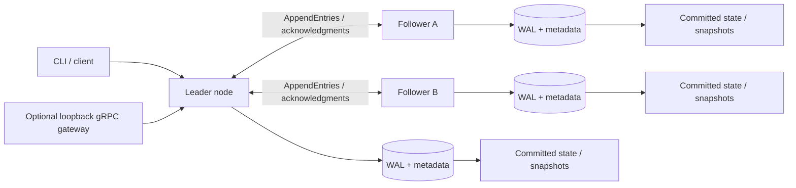

# Choreo Log (ChoreoOS)

**A C++20 learning-oriented distributed runtime that keeps a replicated event history recoverable across node crashes, restarts, and lagging replicas.**

When several machines maintain the same state, a write cannot be trusted merely because one machine saved it. Choreo Log explores the practical boundary between **persisted**, **committed by a majority**, and **applied to the state machine**—using choreography events (dancers, formations, cues) as an easy-to-follow workload.

Independently built by **Albert Mejooli**, a Computer Science and Business student at the University of Rochester. This is an engineering project, **not a database, message broker, production-ready consensus library, or fully verified Raft implementation**.

### In 30 seconds

- **Replicate:** three-node TCP clusters with majority-based write commitment; fixed-leader mode and an optional Raft-like election mode.
- **Recover:** CRC-protected write-ahead logging (WAL), snapshots, replay, and lagging-follower catch-up. A WAL is a durable record written before the corresponding update is regarded as safely stored.
- **Protect consistency:** committed-prefix protection, retry receipts and deterministic state hashes; failure behavior is covered by focused tests, not by an unrestricted fault-tolerance claim.
- **Explore internals:** selectable legacy and transition-core runtimes, bounded transport queues, optional certificate-bound peer mTLS, and a separate management gateway.

**Start here:** [60–120 second guided demo and recording script](docs/demo.md) · [Engineering overview](docs/project-overview.md) · [Protocol](docs/protocol.md) · [Build and test](docs/development.md)

**Stack:** C++20, CMake, Boost.Asio, OpenSSL, GoogleTest, TCP; optional gRPC management service and generated C#/.NET client. Avalonia UI and Temporal worker are future work.

## Architecture



*Conceptual three-node layout, not a promise of arbitrary placement or Byzantine security. Real peer mTLS is optional; plaintext is appropriate only for trusted loopback development. The gateway is a separate optional build. The transition backend is selected explicitly; the legacy backend remains the default.*

### One write, step by step

1. A client sends a typed choreography command to the leader (a follower can redirect).
2. The leader records the proposed log entry and replicates it to followers.
3. **Persisted** means a node has recorded data durably; it does **not** mean the cluster committed it.
4. **Committed** means the applicable majority/term rules establish the entry as authoritative. The leader's client success path also verifies committed application/receipt state before reporting success.
5. **Applied** means committed events have been incorporated into the deterministic choreography state. State hashes provide a testable correspondence check.

See [protocol details](docs/protocol.md), [transition runtime storage ordering](docs/transition-runtime.md), and [persistence format and recovery](docs/persistence.md). These stages are related but not interchangeable.

### What happens during failure?

With three members, one unavailable follower leaves a two-node majority able to commit writes under the tested scenarios. A returning follower receives bounded missing-entry batches or a verified snapshot if the earlier history has been compacted. Conflicting *uncommitted* suffixes can be repaired; committed history must not be overwritten. An isolated leader without a majority cannot legitimately commit new writes. See [failure walkthrough](docs/project-overview.md#failure-and-recovery-example) and [cluster integration tests](cpp-runtime/tests/integration/cluster_test.cpp).

## Run, test, and demonstrate

**Prerequisites:** CMake ≥3.28, a C++20 compiler, Ninja (Linux preset), vcpkg with the project's manifest dependencies, and Python 3 for the recovery demonstration. On Windows, use the documented Visual Studio/vcpkg setup.

Linux (after setting `VCPKG_ROOT`):
```bash
cmake --preset linux-gcc
cmake --build --preset linux-gcc
ctest --preset linux-gcc --output-on-failure
python3 scripts/check_runtime_recovery.py \
  --node build/linux-gcc/cpp-runtime/choreoos-node \
  --cli build/linux-gcc/cpp-runtime/choreoos-cli \
  --replay build/linux-gcc/cpp-runtime/choreoos-replay
```

Windows PowerShell (using the documented Windows preset and Debug executables):
```powershell
.\scripts\dev.ps1 check
python scripts/check_runtime_recovery.py --node build/windows-msvc/cpp-runtime/Debug/choreoos-node.exe --cli build/windows-msvc/cpp-runtime/Debug/choreoos-cli.exe --replay build/windows-msvc/cpp-runtime/Debug/choreoos-replay.exe
```

The recovery script uses its own temporary directory, runs a real node, kills and restarts it, checks writer exclusion, original-operation retry receipts and storage compatibility, then cleans up. **It is a single-node process-recovery demonstration**, not proof of three-node failover. Its expected terminal success line begins `PASS: transition process writes/recovery`; a nonzero exit or traceback means failure. The three-node evidence is in [legacy cluster tests](cpp-runtime/tests/integration/cluster_test.cpp) and [transition cluster tests](cpp-runtime/tests/integration/transition_cluster_test.cpp). The commands above are based on checked source/presets; they were **not executed in this documentation-only environment**.

For the narrated two-minute walkthrough and safe recording instructions, see [docs/demo.md](docs/demo.md).

## Engineering deep dive

| Question | Start here |
|---|---|
| How are leaders elected and replicated indexes matched? | [Protocol](docs/protocol.md), [legacy replica](cpp-runtime/src/replication/replica.cpp), [transition core](cpp-runtime/src/raft/transition.cpp) |
| What survives restart? | [Persistence](docs/persistence.md), [WAL](cpp-runtime/src/storage/wal.cpp), [snapshots](cpp-runtime/src/storage/snapshot.cpp) |
| How are writes gated on durability and application? | [Transition runtime](docs/transition-runtime.md), [host](cpp-runtime/src/raft/runtime_host.cpp) |
| What does a repeat request mean? | [Transition runtime retry mapping](docs/transition-runtime.md), [cluster tests](cpp-runtime/tests/integration/transition_cluster_test.cpp) |
| How do management clients work? | [Management gateway implementation](cpp-runtime/apps/management/main.cpp), [status and state pagination](docs/protocol.md#status-state-pages-and-capacity) |
| What has and has not been formally checked? | [Verification scope](docs/raft-verification.md), [read-barrier limitations](docs/raft-read-barriers.md) |

## Performance: evidence and limits

A previously reported median commit-latency change was **45.5 ms → 17.1 ms**, a **62.4% reduction** when calculated as `(45.5−17.1)/45.5`. This is **historical author-reported information, not a newly reproduced measurement**. The checked repository sources did not establish a matching raw before/after dataset, hardware configuration, sync policy, sample count or exact comparative commit SHAs, so this README does not promote the figure as a verified benchmark result.

The repository does include [benchmark harnesses](cpp-runtime/benchmarks/bench_cluster.cpp) and [a runner](scripts/run_benchmarks.sh). Notably, `BM_CommandToCommitLatency` advances a *simulated network* and records **logical ticks**, not TCP round-trip milliseconds. Its result cannot independently substantiate the 45.5/17.1 ms claim. To establish a comparable result, archive raw runs for both commits, specify 3-node topology, workload, disk sync settings, machine/OS, warmup and samples, and verify state hashes and commit receipts after each run. See [benchmark notes](docs/project-overview.md#performance-evidence).

## Scope and boundaries

- **Implemented:** deterministic event state machine, WAL/snapshot storage, static-membership replication and election modes, selectable integrated transition runtime, optional peer TLS, loopback management gateway (optional build), recovery and cluster integration tests.
- **Tested in scoped scenarios:** majority commitment, committed-prefix protection, restart/catch-up and snapshot transfer, durable retry behavior, and authenticated peer scenarios. Tests are not exhaustive consensus proofs.
- **Not claimed:** Byzantine security, dynamic membership, unrestricted availability, exactly-once external effects, formal model-to-C++ refinement or linearizable public reads. A transition-core quorum-read primitive exists but is **not exposed as a linearizable management read API**.
- **Planned:** Avalonia dashboard, Temporal workflow worker, further read integration and snapshot-aware formal correspondence.

See [engineering overview](docs/project-overview.md), [source-level documentation index](docs/README.md), and [project plan](PLAN.md) for additional context.
